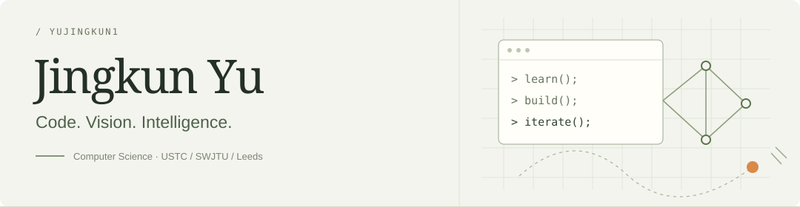

  

  <a href="https://scholar.google.com/citations?hl=en&amp;user=F-VIe5IAAAAJ">Google Scholar</a>
  &nbsp; · &nbsp;
  <a href="mailto:yujingkun05@163.com">Email</a>
  &nbsp; · &nbsp;
  <a href="https://github.com/yujingkun1?tab=repositories">Projects &amp; code</a>

### Hi, I'm Jingkun Yu / 于景坤 👋

A Computer Science student interested in **visual intelligence, multimodal learning, and building useful tools**. I like turning ideas into working code and understanding the methods behind the results.

- 🎓 Incoming master's student at **[USTC](https://en.ustc.edu.cn/)**, joining **[VIDAR](https://vidar-ustc.github.io/)** with **[Zhiwei Xiong](http://staff.ustc.edu.cn/~zwxiong/)**.
- 📚 Dual undergraduate degrees from **[Southwest Jiaotong University](https://www.swjtu.edu.cn/)** and the **[University of Leeds](https://www.leeds.ac.uk/)**, through the SWJTU–Leeds Joint School. Undergraduate research in **[Luo Lab](https://luolab-swjtu.github.io/)** with **[Zhipeng Luo](https://faculty.swjtu.edu.cn/luozhipeng/zh_CN/index.htm)**.
- 🔬 Research internships at **Peking University** with **[Yao Sui](https://www.ai.pku.edu.cn/info/1140/2878.htm)** (Feb–Jul 2026) and **Westlake University** with **[Haoyang Li](https://hy-li.com/)** (Apr–Nov 2026).

### Research interests

`Computational pathology & spatial omics` · `Computer vision & multimodal learning` · `Medical AI`

My research focuses on learning meaningful representations and designing robust algorithms for complex visual and multimodal data.

| Selected work | What I'm exploring |
| :--- | :--- |
| **[BREST](https://github.com/yujingkun1/BREST)** | Bulk RNA-seq enhanced spatial transcriptomics prediction from pathological images. |
| **SPORT** | Semi-supervised structure learning and dual-space optimal transport for multimodal medical image registration. |

Both are research manuscripts. At Westlake, my work centers on **multi-omics prediction for virtual tissue**.

### Things I build

- **[QQ Group Annual Report Analyzer](https://github.com/ZiHuixi/QQgroup-annual-report-analyzer)** — Built with [Huixi](https://github.com/ZiHuixi). Discovering hotwords and activity patterns, then turning conversations into a visual year in review. Python · Flask · Vue.
- **[Learning notes](https://github.com/yujingkun1/Learning-notes-of-jingkun)** — A place to keep what I learn along the way.

**Working with:** Python · PyTorch · Flask · React · Vite

  
<b>A few milestones</b>

- SWJTU–Leeds Joint School Special Scholarship, Second Class — **3/80**.
- University Merit Student · Outstanding Student Cadre.
- First Prize, China Robotics and Artificial Intelligence Competition (2025).
- Meritorious Winner, Mathematical Contest in Modeling (2024).

### Beyond the screen

🏓 **Table tennis** &nbsp; · &nbsp; 🏋️ **Fitness** &nbsp; · &nbsp; 🎮 **Gaming**

Honor of Kings · PUBG · VALORANT · GTA · Red Dead Redemption

Keep learning. Keep building.

